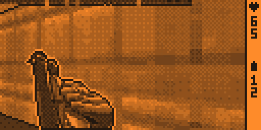

# DOOM for Flipper Zero

The real Doom engine on a stock Flipper Zero: all nine maps of Knee-Deep in the
Dead, in shades of gray on the 1-bit LCD, with the original sound effects and
music from the piezo speaker. It is an ordinary app (FAP) for the official
firmware, no custom firmware needed.



*Doom's own demo3 recording (E1M7) through this port, rendered by the PC
simulator the way the Flipper's screen looks to the eye (screen grabs from
qFlipper show single subframes, which look like noise). It uses one unit's
calibration (8 levels, gamma 0.8, 75 Hz). Flipper screens differ from unit to
unit, so on yours the grays can look lighter, darker or less even than here.*

## What it does

- **The actual engine.** [Doom8088](https://github.com/FrenkelS/Doom8088) (a
  16-bit DOS port of GBADoom/PrBoom), not a raycaster look-alike: BSP renderer,
  monsters, doors and lifts, all of E1's maps and secrets, five skill levels.
- **Gray on a 1-bit LCD.** The screen flashes up to 8 subframes per gray cycle in
  step with the LCD controller's own frame rate (75 Hz); a calibration screen finds
  that rate and the gamma for your unit. The image is dithered with outlines
  taken from the renderer, so walls and monsters stay readable at 128x64. How
  it works: [docs/grayscale.md](docs/grayscale.md), free for anyone to reuse.
- **Sound and music.** Doom's digitized effects through 8-bit PWM + DMA on the
  speaker; the music is Bobby Prince's MUS tracks rendered with the DMX OPL
  instrument bank and streamed from the SD card.
- **Doom's menu.** New Game (level, skill), Options (sound volume sliders,
  screen calibration), Read This!, Quit with Doom's quit messages, the skull
  cursor and menu sounds, over a recorded demo.

## How it fits

A Flipper app runs from RAM, and Doom does not fit in what is left of it. So:

- **The engine runs from flash.** The 104 KB gap between the firmware and the
  radio stack is unused on stock firmware. The app writes the engine image there
  once (with Bluetooth off) and calls into it; the engine's globals are reached
  through its GOT in register r9, the firmware only through a function table.
- **The level lives on the SD card.** About 80 KB of heap is left for Doom's
  zone. Segs, nodes, line and sector data, the WAD directory, sprites and walls
  are read through a demand pager (512-byte pages, filling whatever zone memory
  the level leaves free), and the data structures were shrunk (a 2-byte line, an
  8-byte side, a 36-byte sector, static map things in a 64-byte form...).
- **Offline preprocessing.** `port/tools/fztex.py` adds lumps to the WAD: wall
  textures pre-composed at the screen's resolution, a sprite frame table, each
  sector's line list, sound origin and blockmap cells, the sounds at 11 kHz.

The full story with measurements, including what did not work, is in
[docs/PLAN.md](docs/PLAN.md).

## Performance

Measured on the device; it depends on the map: the bigger it is, the less memory is left for the page
cache and the more the SD card is read.

| | fps |
|---|---|
| E1M1, E1M8 | 20-30 |
| E1M2, E1M4, E1M5, E1M7 | 10-20 |
| E1M3, E1M6, E1M9 in fights | 4-10 |

On Ultra-Violence and Nightmare E1M6 does not fit in memory (more monsters).

## Roadmap

- [x] Doom8088 engine running from the internal flash gap, installed by the app
- [x] All nine maps of episode 1 fit in memory (demand paging from the SD card)
- [x] Gray levels on the 1-bit LCD with per-device calibration
- [x] Renderer-aware dithering: geometry edges, sprite outlines and halos
- [x] Original sound effects and music
- [x] Doom's menu: skill levels, volume sliders, quit messages, demo background
- [x] Level transitions and deaths without losing speed
- [x] Short button presses never lost on slow frames
- [ ] Faster big maps (E1M3, E1M6, E1M9): precomputed line-of-sight data instead of reading the map from the SD card
- [ ] A cheaper gray display (faster subframe building, LCD transfer by DMA) to leave more CPU to the game
- [ ] E1M6 on Ultra-Violence and Nightmare (does not fit in memory yet)
- [ ] Other firmware versions: find a free flash area instead of a fixed address
- [ ] A release build that takes the menu graphics from the player's own WAD
- [ ] Automap
- [ ] Saved games

## Install

You need a Flipper Zero on the official firmware **1.5.1-rc** and your own Doom
1.9 IWAD (the shareware `doom1.wad` works).

**Only firmware 1.5.1-rc is supported.** The engine is written to a fixed flash
address, `0x080BD000`, just past the end of that firmware's code. Another build
may end higher, and writing there would destroy it, so the app refuses to
install on any other version. If you know that your firmware ends below
`0x080BD000` (see its `.map` file), you can override the check by creating the
file `apps_data/flipper_doom/allow_any_firmware` on the SD card, at your own
risk. Better ways to find a free area (or a list of safe firmware versions)
are welcome as contributions.

1. Build (below) or take a release, then copy to the SD card:
   - `flipper_doom.fap` to `apps/Games/`
   - `FZDOOM.WAD` to `apps_data/flipper_doom/`
   - optionally the music `D_*.PCM` to `apps_data/flipper_doom/music/` and the
     menu background `MENUBG.BIN` to `apps_data/flipper_doom/`
2. Turn Bluetooth off, start Games > DOOM: the first start installs the engine
   into flash (a few seconds, a progress bar). Bluetooth can go back on after.
3. Calibrate the screen when asked (it remembers).

Controls: Up/Down walk, Left/Right turn, OK fires, Back uses (doors, switches),
hold Back to leave the game.

Do not connect qFlipper or the CLI while playing: the game uses nearly all the
memory and the extra load can crash the Flipper.

## Build

```sh
# wad/doom1.wad: your IWAD; wad/DOOM8088.WAD: the same IWAD through jWadUtil
# (https://github.com/FrenkelS/jWadUtil)
pip install ufbt pillow numpy
./build.sh
```

Optional parts:

- **Music:** build [libADLMIDI](https://github.com/Wohlstand/libADLMIDI) (in
  WSL here) and run `python port/tools/mkmusic.py wad/doom1.wad wad/music`.
- **Menu background:** in WSL, `port/sim/build.sh` with
  `EXTRA=-DSIGHT_MEMO_TICS=0` (the demo must play back in sync), then
  `FZ_NOHUD=1 FZ_PERIOD=15 FZ_DUMP1=demo.bin ./fzsim -nosound -timedemo demo3`
  and `python port/tools/mkbg.py demo.bin wad/MENUBG.BIN`.
- **Video like the one above:** the same with `FZ_PERIOD=8 FZ_GAMMA=0.8` (your
  calibration), then `python port/tools/lcdvideo.py demo.bin 8 out.mp4`.

The simulator (`port/sim`, 32-bit Linux build) runs the same engine with the
same memory limits (`FZ_ZONE_KB`), counts SD reads and was used to find most
of the problems before they reached the Flipper.

## Layout

| | |
|---|---|
| `port/engine` | Doom8088 with the Flipper changes (marked `flipper-doom`) |
| `port/platform` | video back end, dithering, HUD |
| `port/flipper` | the engine image (linker script, API) and the app (`fap/`) |
| `port/sim` | the PC simulator |
| `port/tools` | WAD preprocessing, music, menu graphics, analysis |
| `tools` | experiments run on the device (flash access, SD speed, gray levels) |

## Credits

- id Software, for Doom and for releasing its source.
- Frenkel Smeijers, for [Doom8088](https://github.com/FrenkelS/Doom8088) and
  [jWadUtil](https://github.com/FrenkelS/jWadUtil), and the GBADoom and PrBoom
  authors before him.
- Vitaly Novichkov, for [libADLMIDI](https://github.com/Wohlstand/libADLMIDI).
- The idea of gray levels by flashing frames on an ST7567 comes from zephray's
  work on monochrome LCDs.

## License

Copyright (C) 2026 HedgDifuse. This is the original repository of this port.

GPL-2.0-or-later, as Doom8088 (see [LICENSE](LICENSE)). The files written for
this port carry the notice above; in the files that come from Doom8088 the
changes made for this port are marked `flipper-doom`, and their original
copyright notices are kept. Forks and redistributions must keep these notices
(GPL-2.0, sections 1 and 2). Doom's game data is not part of
this repository: bring your own IWAD.

The gray-level technique, as described in [docs/grayscale.md](docs/grayscale.md),
is dedicated to the public domain (CC0): use it in any project.
